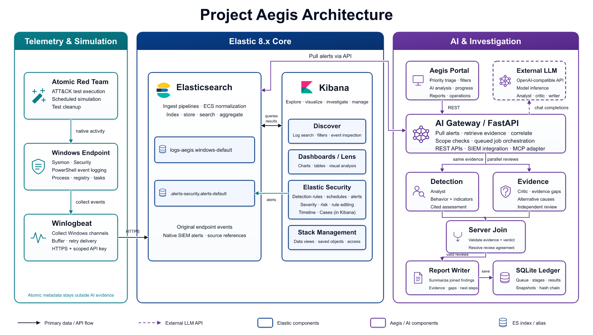
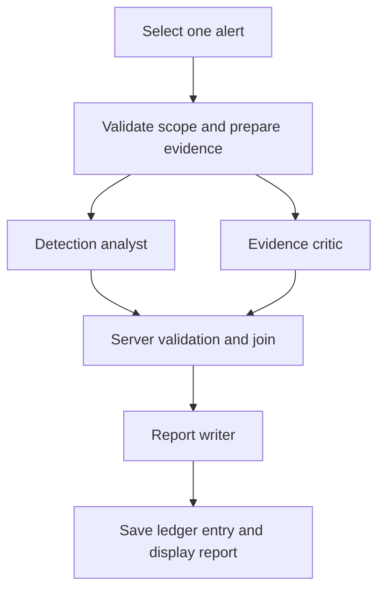
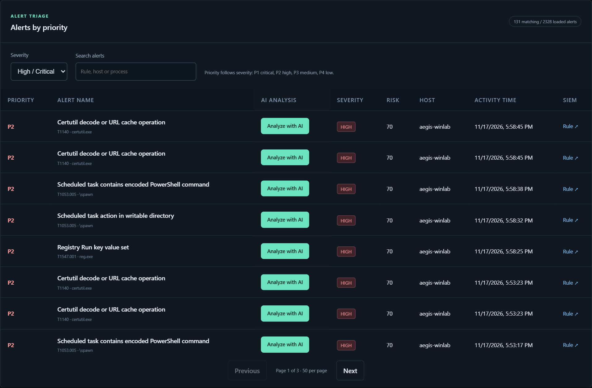
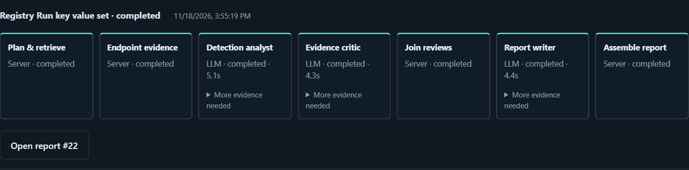
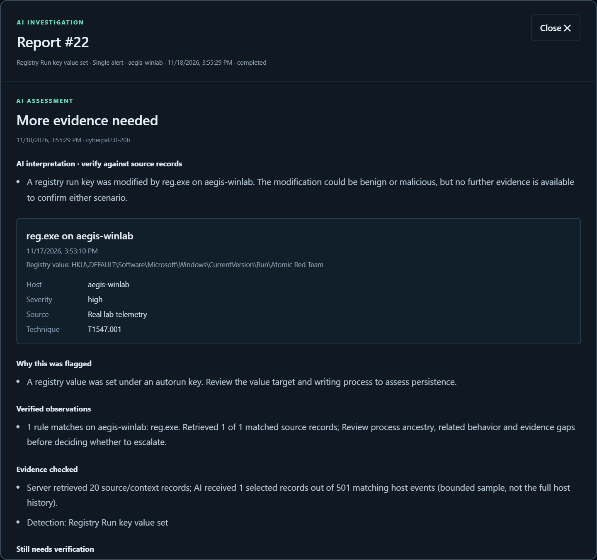
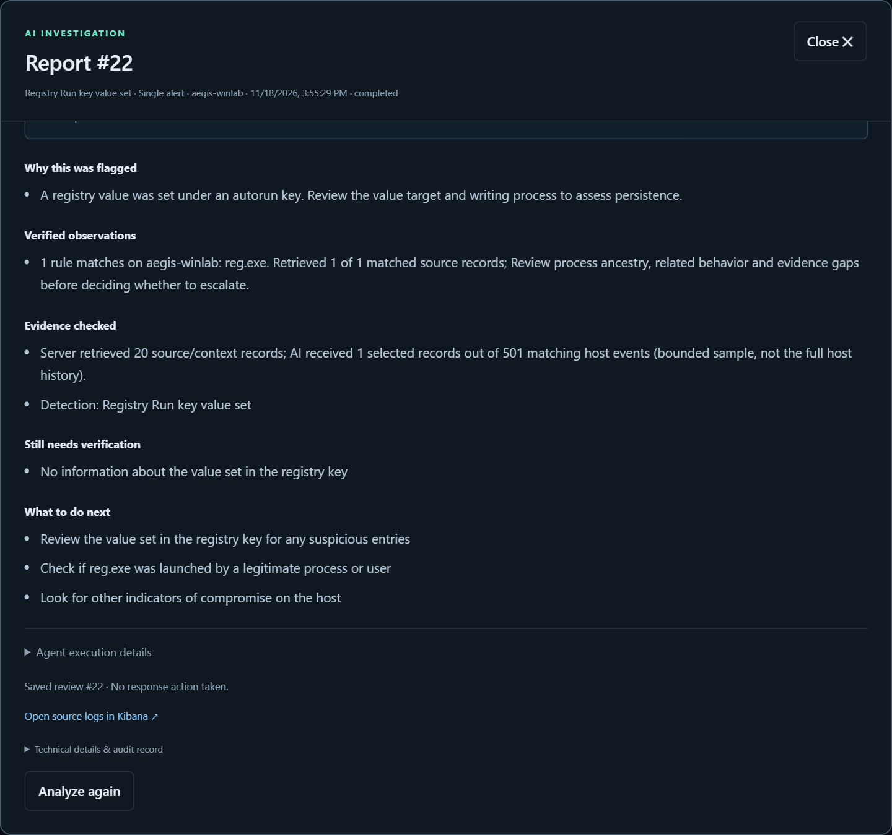

# Project Aegis

[](LICENSE)
[](docker-compose.yml)


Project Aegis is a SOC and threat-hunting lab combining Windows telemetry, native Elastic Security detection, and AI-assisted investigation. Analysts can prioritize alerts, inspect source evidence, request an investigation for a specific alert, and review saved reports and execution history.

The stack uses FastAPI for the backend, Elasticsearch for logs and alerts, SQLite for investigation jobs and the ledger, and an external OpenAI-compatible LLM gateway. Atomic Red Team generates test activity inside a Windows VM.

## Features

- Collect Sysmon, Security, and PowerShell events through standalone Winlogbeat over HTTPS.
- Search and inspect logs in Kibana Discover, and build charts and dashboards with Lens.
- Execute native Elastic Security rules and manage their queries, severity, risk, and schedules in Kibana.
- View alert names, priority, severity, risk, host, activity time, and SIEM rule links in the triage queue.
- Investigate a selected alert with parallel analyst and critic reviews, a server-controlled join, and a report writer.
- Persist jobs, stage progress, evidence references, and report snapshots for review.
- Schedule Atomic recipes and monitor collector health, scheduler snapshots, and lab verification results separately from AI analysis.

## Architecture



| Component | Responsibility |
| --- | --- |
| Atomic Red Team | Execute scheduled ATT&CK test recipes and their cleanup steps inside the Windows guest to generate attack simulation activity |
| Windows lab | Run Windows Server Core in QEMU and produce native events from process, registry, scheduled task, and PowerShell activity |
| Sysmon and Windows Event Logs | Record process, registry, scheduled task, and PowerShell activity according to the logging configuration |
| Winlogbeat | Collect configured Windows event channels, buffer events, retry delivery, and send logs directly to Elasticsearch over HTTPS using a restricted API key |
| Elasticsearch | Normalize event fields through ingest pipelines, index and store source events and alerts, and provide search and aggregation APIs |
| Kibana | Search and inspect events in Discover; build visualizations with Lens and Dashboard; manage data views, saved objects, and access through Stack Management |
| Elastic Security in Kibana | Create, edit, enable, and schedule detection rules; manage severity and risk; review alerts; investigate with Timeline and organize findings in Cases |
| Aegis portal | Filter and prioritize alerts, inspect source facts, open native SIEM rules, start per-alert AI analysis, and display job progress, saved reports, and lab operations |
| FastAPI gateway | Serve the portal and APIs, pull SIEM alerts, retrieve and correlate evidence, validate investigation scope, and orchestrate queued investigation jobs |
| External LLM gateway | Provide the configured model for analyst, critic, and writer requests through the chat completions API |
| SQLite jobs and ledger | Persist the queue, progress, results, and hash-linked investigation snapshots |

Kibana is the interface for log exploration, visualization, SIEM detection management, and stack administration. Aegis provides a separate alert triage and AI investigation workspace. Timeline and Cases are native Kibana capabilities; Aegis does not automatically create cases or write investigation dispositions back to the SIEM. Dashboards and visualizations can be created in Kibana; the architecture diagram does not imply that a custom dashboard pack is installed.

Native alerts are read through `.alerts-security.alerts-default`. Aegis retrieves their source references and synchronizes projections into `aegis-alerts-default` for the portal. Windows source events are stored in `logs-aegis.windows-default`.

Fleet Server and Elastic Agent provide a separate agent-management path in the base Compose configuration. The Windows collector uses standalone Winlogbeat. Qdrant and Spark belong to the `advanced` profile; the Python synthetic event generator belongs to `simulation`. These services are independent of the Windows investigation path.

## AI Investigation Workflow



The detection analyst and evidence critic receive the same evidence and run in parallel with separate prompts on the same configured model. The analyst assesses observed behavior and suspicious indicators. The critic independently examines evidence gaps and alternative explanations.

The server retains a shared assessment only when both specialist responses are valid and agree. Disagreement or a specialist failure produces `inconclusive`. The report writer synthesizes valid reviews while the server join remains authoritative for the final assessment. A normal run uses three model requests, with at most one shared JSON repair request.

Source and context retrieval are bounded by host and time scope. The model receives compact alert facts and matched source representatives; other nearby records remain in the audit and are not automatically included in prompts. Evidence IDs are validated before a decision is saved.

Atomic generates test activity. Schedules, test GUIDs, and runner records are excluded from AI investigation inputs. Recommended checks require analyst review; the system does not execute response actions.

## AI Investigation in Action

The screenshots below show the running Aegis portal and a saved investigation using an external LLM gateway. The example reviews a high-severity Registry Run key alert (`T1547.001`) from Windows endpoint telemetry.

### Select an Alert

Filter the triage queue by severity or search for a rule, host, or process. **Analyze with AI** starts an investigation scoped to that alert; **View AI report** reopens its saved result when available in recent history.



### Inspect the Investigation Stages

The execution history distinguishes server stages from model calls and records each stage's status and duration. **Open report** opens the saved investigation in a dialog.



### Review the Report

The report presents the AI interpretation alongside endpoint facts, the rule condition, source evidence coverage, missing information, and recommended checks. The analyst can compare the interpretation with the underlying records instead of relying on the verdict alone.



<details>
<summary>Evidence coverage, follow-up checks, and saved audit record</summary>

The report identifies the bounded evidence sample, lists what still needs verification, and provides a link to Kibana plus the saved technical record. In this example, the server retrieved 20 source/context records and supplied one selected source record to the model.



</details>

| Observed in the example run | Result |
| --- | --- |
| Analyst, critic, and writer | All completed; three model requests, no repair request |
| Saved investigation | Report #22; single-alert scope |
| Final assessment | `inconclusive`, displayed as **More evidence needed** |
| Ledger integrity check after saving | Valid hash chain across 22 entries |

> [!NOTE]
> Captured on November 18, 2026, using saved Windows lab telemetry from November 17. Alert counts, model choice, report IDs, and timestamps belong to this example. A completed investigation means the workflow produced a validated, saved report; it does not establish that an alert is malicious. This run demonstrates the investigation and reporting path, not detection accuracy or fresh Windows ingestion. AI recommendations remain subject to analyst review, and no response action is executed.

## Requirements

- Docker and Docker Compose.
- Python 3.11 and the dependencies in `requirements.txt`.
- KVM or nested virtualization for the Windows VM.
- Access to an OpenAI-compatible chat completions gateway for AI investigations.

Default resource limits allocate 2 GiB to Elasticsearch, 1 GiB to Kibana, and 2 GiB to the Windows guest. Allow additional resources for the host OS, Docker, and other services. Windows uses an evaluation ISO and a separate virtual disk.

## Installation

Run the following PowerShell commands from the project root. Preserve existing environment files and volumes when working with an established deployment.

### 1. Prepare the Environment

```powershell
if (!(Test-Path .env)) { Copy-Item .env.example .env }
python -m venv .venv
.\.venv\Scripts\python.exe -m pip install -r requirements.txt
```

Set individual `ELASTIC_PASSWORD` and `KIBANA_PASSWORD` values in `.env`. Choose `AEGIS_GATEWAY_PORT` if you need a different portal port, and set `AEGIS_GATEWAY_TOKEN` to protect the APIs with a bearer token.

Prepare the persistent Kibana encryption key before running Compose:

```powershell
.\.venv\Scripts\python.exe scripts/setup_native_siem.py --prepare
```

### 2. Start Storage and SIEM

```powershell
docker compose up -d es01 kibana

# Prepare ingest pipeline, mappings, collector credentials and guest staging.
.\.venv\Scripts\python.exe scripts/prepare_windows_lab.py

# Wait for Kibana and create lab data views.
.\.venv\Scripts\python.exe scripts/setup_kibana_views.py

# Register missing native rules and enable native SIEM mode in .env.
.\.venv\Scripts\python.exe scripts/setup_native_siem.py

docker compose up -d --build ai-gateway
```

The seeder preserves existing SIEM rule definitions, including edits and disabled states. Bootstrap JSON supplies initial definitions; Elastic Security owns live queries and schedules. Keep the `aegis` tag on rules that should participate in the portal workflow.

### 3. Start the Windows Lab

```powershell
.\.venv\Scripts\python.exe scripts/prepare_windows_lab.py --start --run-smoke
```

This starts the Windows VM and enables the T1057 smoke test after provisioning. Once guest installation completes, run the following **inside the Windows guest** to configure the detection pack and enable the expanded schedule:

```powershell
powershell.exe -NoProfile -ExecutionPolicy Bypass -File //host.lan/data/Install-AegisDetectionPack.ps1
```

The schedule runs ten recipes every five minutes, covering discovery, encoded PowerShell, Run keys, task creation, and certutil decoding.

### 4. Connect an LLM Gateway

Configure `.env`:

```dotenv
AEGIS_LLM_BASE_URL=https://llm-gateway.example/
AEGIS_LLM_MODEL=your-model-id
AEGIS_LLM_API_KEY=
```

Replace the URL and model with your provider configuration. Supply an API key if the gateway requires one.

Recreate the gateway to apply the configuration:

```powershell
docker compose up -d --build ai-gateway
```

## Usage

| Interface | Default Address |
| --- | --- |
| Aegis portal | `http://localhost:8000` |
| Kibana SIEM | `http://localhost:5601` |
| Windows web console | `http://localhost:18006` |
| Windows RDP | `localhost:13389` |

The portal uses `AEGIS_GATEWAY_PORT`; choose 18080 if port 8000 is occupied. `KIBANA_PUBLIC_URL` controls the destination of browser links to SIEM.

1. Open the portal, enter the gateway token if configured, and select a time range.
2. Filter by severity or search for a rule, host, or process. P1/P2/P3/P4 map to critical/high/medium/low; severity and risk come from detection.
3. Click an alert name to inspect its source facts or open its SIEM rule editor.
4. Click **Analyze with AI** on an alert, follow stage progress, and open the saved report in a dialog. Closing the dialog leaves the job running on the server.
5. Use **View AI report**, **Analyze again**, or AI analysis history to review results or explicitly request another investigation.

Native detection follows SIEM schedules. **Sync SIEM alerts** synchronizes saved alerts into the portal; it does not execute native rules again. LLM calls occur only when an investigation is requested.

## Operational Limits

- One gateway process and one investigation worker, with up to 10 active jobs. Queued jobs resume after restart; running jobs become `interrupted` to avoid silently repeating paid calls.
- The projection bridge polls approximately every 30 seconds and retrieves up to 1,000 native alerts from the latest 60 minutes. It has no durable backfill cursor.
- Correlation uses fixed UTC buckets and a query budget. Incomplete coverage blocks investigation until the analyst narrows the scope.
- The ledger uses a local hash chain without an external immutable anchor. The portal displays recent jobs and does not provide full-history case management.
- `/mcp` exposes a JSON-RPC adapter subset. The portal uses REST orchestration.
- This is a single-user lab. RBAC, multitenancy, RAG/vector retrieval, and distributed workers are outside the investigation workflow.

Keep `.env` and `lab/runtime/` out of version control. Retain the Kibana encryption key, certificates, and data volumes across restarts. Back up the SQLite ledger and Elasticsearch data before replacing volumes. The gateway uses server-side ES and LLM credentials; keep it on a trusted network and configure its bearer token before exposing its APIs.

## Validation

```powershell
.\.venv\Scripts\python.exe -m unittest discover -s tests
```

Unit tests do not verify guest provisioning, live log ingestion, native rule execution, or connectivity to an external LLM gateway. Validate those against the running lab separately.

## License

Project Aegis is released under the [MIT License](LICENSE).
